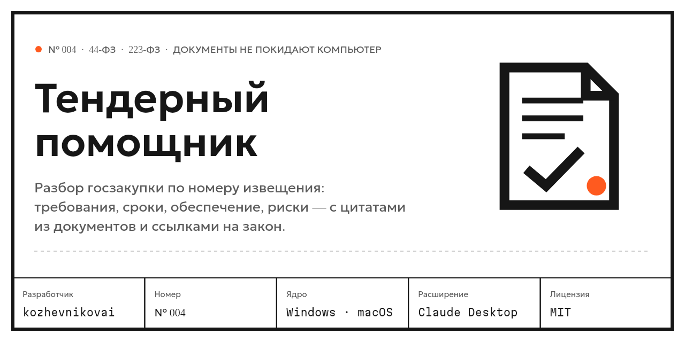

# Tender Assistant (Тендерный помощник)

**Analyzes a Russian public procurement notice (44-FZ and 223-FZ) by its number: requirements, deadlines, bid and contract security, anti-dumping, risks and draft letters — every claim backed by a quote from the documents and a reference to the law.** Built for small businesses. The interface and reports are in Russian.

[Русская версия](README.md)

Enter a notice number and the assistant downloads the notice card and attachments from the public part of the Unified Procurement Information System (EIS, zakupki.gov.ru), reads PDF, DOCX, DOC, ZIP and scans, and produces:

- **Key facts** — initial maximum price, submission deadline with the customer's time zone, procedure, platform, bid and contract security.
- **Can we bid?** — "yes / no / need" against your company profile: SME status, licences, SRO membership, experience, national regime and registry numbers, cash for security, region.
- **Money** — security (Art. 44, Art. 96), anti-dumping (Art. 37), fines (Government Decree No. 1042), daily penalty, margin.
- **Risks** — payment term over 7 working days, too-short submission period, unlawful security or fines, brand without "or equivalent", tailored specifications, unrealistic deadlines, number vs. words mismatch.
- **Deadlines** to `.ics`, **application checklist**, **offer check against the specification**, **drafts** of a clarification request and an FAS complaint (Word), **contract execution plan** after winning.
- **Monitoring** via the official EIS RSS with Telegram and e-mail alerts; **Bitrix24** deals and a CSV registry for Excel / Google Sheets.

## Accuracy

Facts about the procurement come with a verbatim quote and page/paragraph; quotes that are not found in the text are never shown. Statements about the law come only from the [rule base](rules/rules.json) — article, effective dates, 2+ sources; anything less is marked "check". The language model never extracts facts.

Evals on 36 real EIS notices: **100 %** of 205 checks on the main set and **100 %** of 105 checks on a hold-out set (98 % on its first run) when analyzing by notice number; 100 % of quotes found verbatim. See [evals/results.md](evals/results.md).

## Safety

Never submits bids, never signs, never touches digital signatures or platform passwords. Company documents and profile stay on your computer; a cloud model (Claude with your key or any OpenAI-compatible API) is opt-in with personal data masked. Only public EIS pages are read, at most one request per second. **This is an assistant, not legal advice.**

## Install

- **App**: Windows `.exe`, macOS `.dmg` (beta, unsigned) — [Releases](https://github.com/kozhevnikovai/tender-pomoshnik/releases).
- **Claude Desktop**: open the `.mcpb` file from Releases.
- **CLI** (Node.js 20+): `npx tender-pomoshnik analyze 0372200092126000031`, `npx tender-pomoshnik mcp`.

## License

MIT · kozhevnikovai · No. 004
